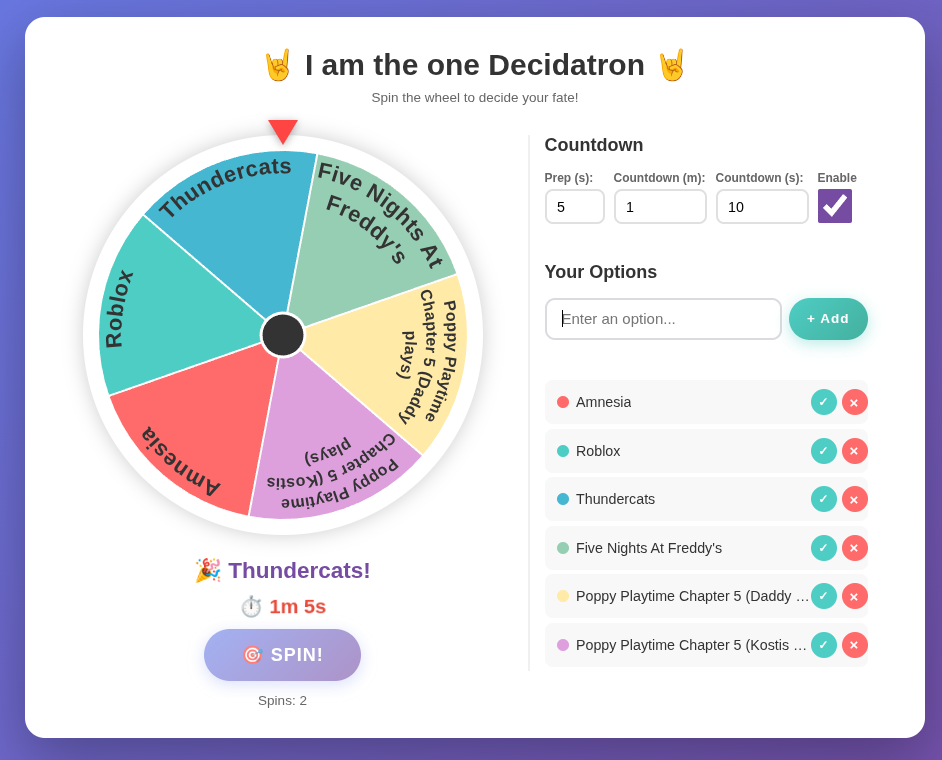

# decidatron
Having trouble making decisions? Want someone else to make them for you? Are you perhaps a Libra? Well, fret no more,
the Decidatron is here. Add a list of options or activities and spin the wheel. You can also set the duration of each
activity, and have the Decidatron alert you when you're done. Happy sailing!



# running the application on docker
Create a docker-compose.yml file:
```yml
services:
  decidatron:
    container_name: decidatron
    image: ctsag/decidatron:latest
    ports:
      - <PORT>:80
    environment:
      - ALLOWED_HOSTS=<HOST>
    restart: unless-stopped
```

or, if you prefer, simply execute

```bash
docker run -d \
  --name decidatron \
  -p <PORT>:80 \
  -e ALLOWED_HOSTS=<HOST> \
  --restart unless-stopped \
  ctsag/decidatron:latest
```

Replace `<HOST>` and `<PORT>` with an appropriate value. For example, if you intend to use it via http://localhost:8002 , the value
for `<HOST>` should be `localhost` and the value for `<PORT>` should be `8002`.